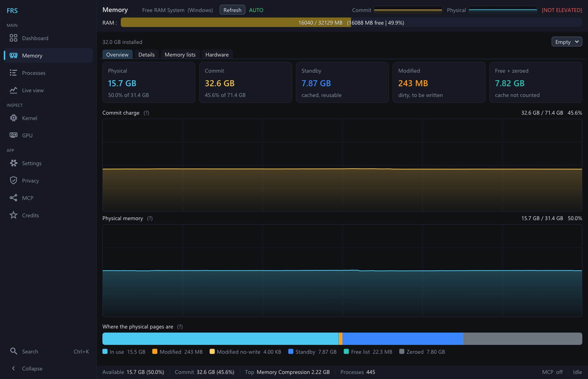
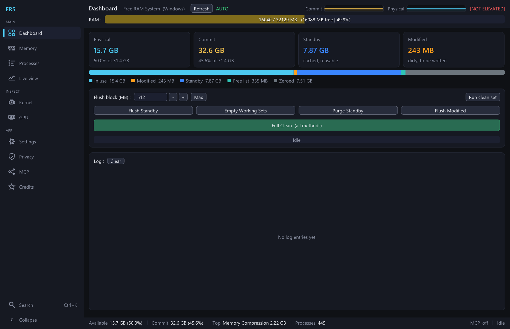
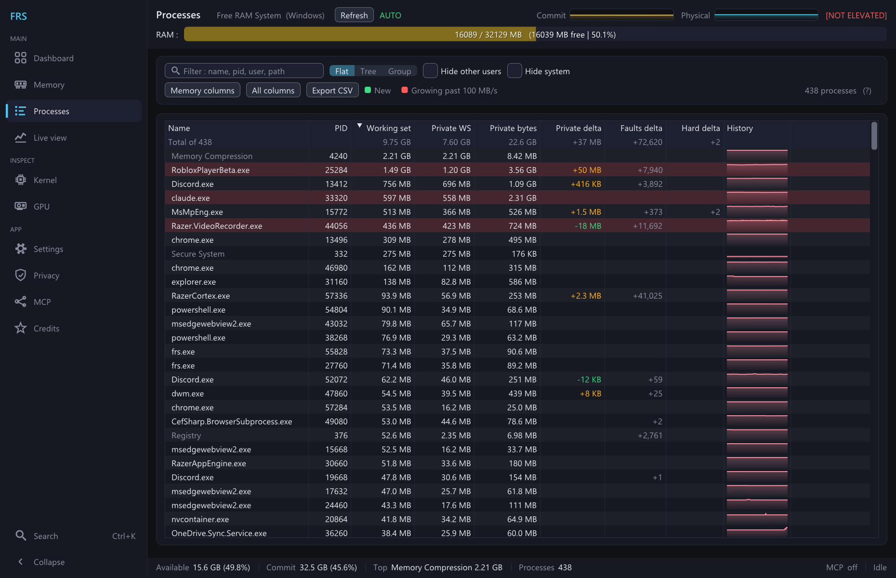
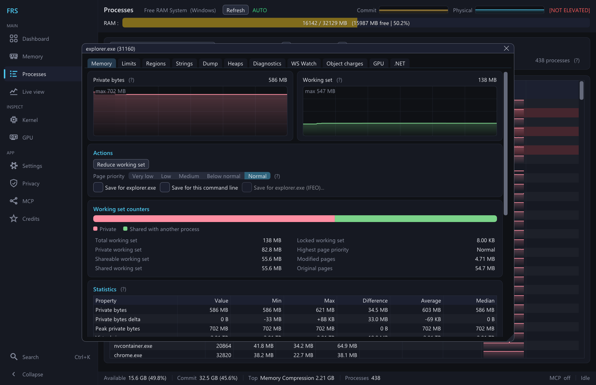
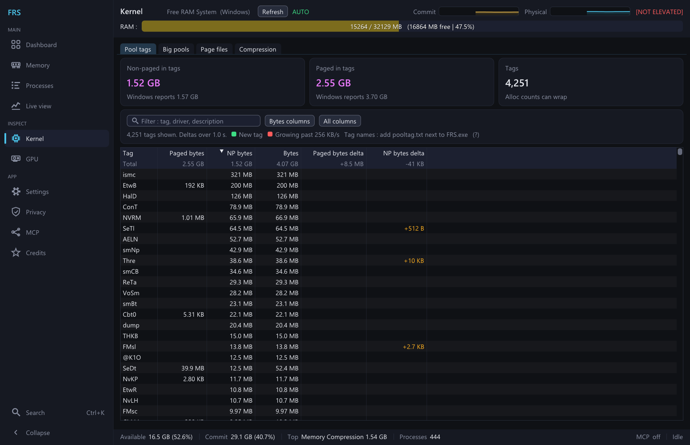
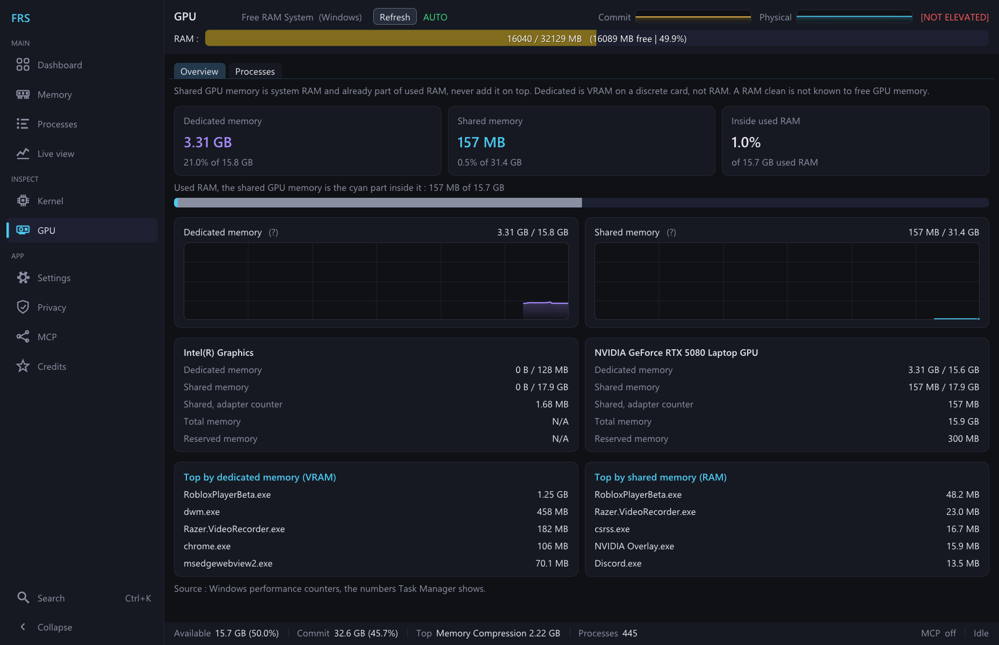
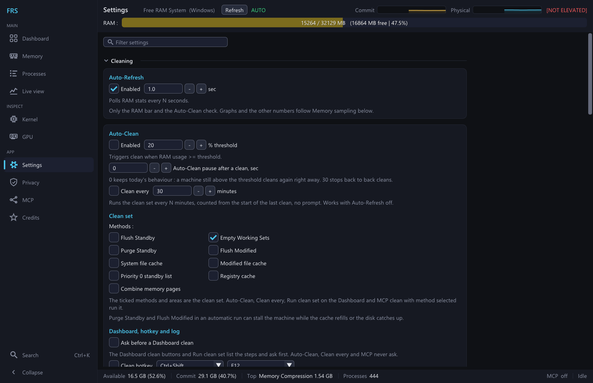
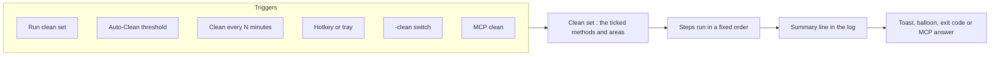

<div align="center">


# FRS

**Free your RAM. See where it went. Let your AI agent keep watch.**

Free RAM System : a native C++ RAM cleaner and memory inspector for Windows and Linux,<br>
with System Informer's memory views, Mem Reduct style automation and a built-in MCP server.


[](LICENSE)

[What's new](#whats-new-in-v2) · [Features](#features) · [Screenshots](#screenshots) · [How a clean works](#how-a-clean-works) · [Quick start](#quick-start) · [MCP server](#mcp-server) · [Command line](#command-line) · [Building](#building)

</div>



> Because Microslop is too busy shipping another AI powered slop to bother freeing the 4 GB of RAM that Copilot, Teams, and Windows Search quietly ate while you weren't looking.

## What's new in v2

v2 is a major update over v1.2 : FRS goes from four clean buttons to a full memory tool.

- **New UI.** A sidebar with pages instead of tabs, a Ctrl+K palette, a status bar, small graphs in the header, the Live view page and a reworked theme.
- **System Informer's RAM features.** The [Memory](#memory-page), [Processes](#processes-page), [Kernel](#kernel-page) and [GPU](#gpu-page) pages and a [window per process](#process-window) with its regions, hex editor, strings, dumps, heaps, WS Watch and more. Of 1707 System Informer features 1093 are done, 207 work another way, 397 were left out and 10 need its kernel driver, see [the coverage list](docs/SYSTEM_INFORMER_COVERAGE.md).
- **Mem Reduct's features.** The clean set with five more areas, a clean timer, a pause after a clean, a summary line, a global clean hotkey, tray icons with a menu and middle click, a balloon after a clean, a [command line](#command-line) (`-clean`, `-silent`, `-minimized`...), a log file, single instance, the saved window position, start minimized, portable mode, Reset settings and the no-prompt shortcut. Of 159 Mem Reduct features 107 are done, 8 work another way and 44 were left out, see [the coverage list](docs/MEMREDUCT_COVERAGE.md).
- **MCP server.** [38 tools](#tools) (up from 10) in Read, Write and Danger tiers, a mode per tool (Off, Ask or On) with a prompt for Ask, and a live activity log. Danger tools are off by default and refused while LAN is on.
- **Linux fixes.**
	- FRS asks for root itself through pkexec, like the UAC prompt on Windows. Cancel it and FRS runs without root
	- a hidden or minimized window no longer freezes Auto-Clean and the MCP server on Wayland
	- settings stay in your own `~/.config/FRS` when FRS runs as root, the folder is private (it holds the MCP token), and files older builds left owned by root are given back to you
	- Flush Standby stays under the available RAM, so it no longer wakes the OOM killer
	- Empty Working Sets works on glibc before 2.33 and no longer stops short on regions over 2 GB
	- single instance and window placement like Windows
- **Build.** A `Makefile` that only recompiles what changed, `make MANIFEST=0` for a test build.

**Upgrading from v1.2** : drop in the new exe, `settings.ini` carries over. The new cleaning, tray, hotkey and log file options start off, so cleans run as before until you turn them on. A Run at startup task made by v1.2 gets the new task settings once at the next launch (no stop on battery, no time limit, normal priority). On Linux, settings v1.2 left in root's folder come over once. If your own file already exists, your keys win and your file goes to `settings.ini.bak` first.

## Features

- **Clean in one click, or never think about it.** Four methods, the heavy two split across every CPU thread, with a live progress bar. Auto-Clean fires at a RAM threshold, the timer every N minutes.
- **A clean set you pick.** Tick the methods plus five extra areas : system file cache, modified file cache, priority 0 standby list, registry cache and combine memory pages. The Dashboard, Auto-Clean, the timer, the hotkey, the tray, `-clean` and MCP all run the same set.
- **Every byte accounted for.** The Memory page splits RAM into in use, modified, standby, zeroed and free, shows commit, pools, paging and the compression store, and reads your RAM sticks from SMBIOS.
- **Every process, every memory column.** Private bytes, the working set split, faults, pools, page priority and a sparkline, in Flat, Tree or Group view.
- **Look inside one process.** Its memory map, a hex editor, string search, dumps, heaps, a page fault watch and more, one window per process.
- **Kernel and GPU memory too.** Pool tags with deltas to catch driver leaks, big pools, page files, the compression store, and GPU memory per adapter and per process.
- **Lives in the tray (Windows).** Graph or percent icons, a menu with every clean, a global hotkey and a balloon after a clean. All off until you turn them on.
- **Built for AI agents.** A local MCP server with 38 tools, so Claude Code, Cursor or VS Code can watch memory and clean on their own, with the access you give each tool.
- **Privacy tweaks.** About 60 registry tweaks across 10 categories (Windows), each with live status and a clean revert.
- **One file, no installer.** A single static exe on Windows, settings saved on every change, portable mode with one file next to the exe.

## Screenshots

<table>
  <tr>
    <td width="50%"></td>
    <td width="50%"></td>
  </tr>
  <tr>
    <td align="center"><b>Dashboard</b> : clean, watch the page lists, read the log</td>
    <td align="center"><b>Processes</b> : every process with its memory columns</td>
  </tr>
  <tr>
    <td width="50%"></td>
    <td width="50%"></td>
  </tr>
  <tr>
    <td align="center"><b>Process window</b> : graphs, working set split, page priority</td>
    <td align="center"><b>Kernel</b> : pool tags, to catch driver leaks</td>
  </tr>
  <tr>
    <td width="50%"></td>
    <td width="50%"></td>
  </tr>
  <tr>
    <td align="center"><b>GPU</b> : dedicated and shared memory per adapter</td>
    <td align="center"><b>Settings</b> : filter box and folding sections</td>
  </tr>
</table>

<sub>Taken on Windows 11 with a test build that runs without admin rights, so the header says NOT ELEVATED. A normal start shows [ADMIN].</sub>

## How a clean works



One run goes through the ticked steps in this order :

| # | Step | Windows | Linux | Ticked by default |
| --- | --- | --- | --- | --- |
| 1 | **Flush Standby** | parallel allocate, touch, free : forces a standby list flush | parallel `mmap`, touch, `munmap`, capped to the available RAM | |
| 2 | **Empty Working Sets** | `EmptyWorkingSet` on every process, in parallel | `process_madvise(MADV_PAGEOUT)` over each process's regions (kernel 5.10+) | yes |
| 3 | **System file cache** | trims the system cache working set | `sync`, then drops the clean page cache (root) | |
| 4 | **Modified file cache** | flushes dirty file cache on every volume | `syncfs` on every block device and ZFS mount, plain `sync` when there is none | |
| 5 | **Purge Standby** | `NtSetSystemInformation` cmd 4 | `sync` + drop clean page cache via `/proc/sys/vm/drop_caches` (root) | |
| 6 | **Priority 0 standby list** | drops only the lowest priority standby pages | Windows only | |
| 7 | **Flush Modified** | `NtSetSystemInformation` cmd 3 | `sync()` : flush dirty pages to disk | |
| 8 | **Registry cache** | flushes registry hives to disk, may free little | Windows only | |
| 9 | **Combine memory pages** | shares identical physical pages, slow on big RAM | not in the Linux set, see below | |

**Full Clean** stays the four methods (1, 2, 5 and 7). After each run one log line says what it freed, like `Clean : OK, freed 412 MB (available 3.10 GB -> 3.50 GB)`. The Settings page warns that Purge Standby and Flush Modified in an automatic run can stall the machine while the cache refills or the disk catches up.

On Linux, combine starts KSM and leaves it on, a lasting change no automatic run should make, so it stays on the Memory page's Empty menu only. Methods that need root degrade gracefully and report the reason in the log instead of crashing.

## Quick start

### Windows

```bat
setup.bat
build.bat
FRS.exe
```

`setup.bat` fetches MinGW and Dear ImGui the first time, `build.bat` makes `FRS.exe` in the project root. Approve the UAC prompt : the cleans need admin rights.

### Linux

```bash
./setup.sh
./build.sh
./FRS
```

`setup.sh` installs the compiler, GLFW and pkexec through your package manager and fetches Dear ImGui. `./FRS` asks for root through a graphical pkexec prompt, cancel it to run without root.

### Connect your AI agent

1. Open the **MCP** page and tick **Enabled**
2. Hit **Copy** next to "Claude Code" and run the command, or copy the JSON config into any other MCP client. The command looks like this, with your own token :
   ```bash
   claude mcp add --transport http --scope user frs http://127.0.0.1:13337/mcp --header "Authorization: Bearer <token>"
   ```
3. Ask your agent something like *"check what's using my RAM and clean if it's above 80%"*

## Feature guide

The window has a sidebar : **Dashboard**, **Memory**, **Processes** and **Live view**, then **Kernel** and **GPU**, then **Settings**, **Privacy**, **MCP** and **Credits**. Ctrl+K opens a palette that jumps to any page, setting group or memory command, and runs the clean set after asking. F5 takes a memory sample right away.

### Cleaning (Dashboard)

- **Flush Standby** : splits a large allocation across all CPU threads, touches every page in parallel, then frees it to flush the standby list
- **Empty Working Sets** : collects all running process IDs and trims their working sets in parallel across all CPU threads
- **Purge Standby** : calls `NtSetSystemInformation` (cmd 4) to force-purge the standby list
- **Flush Modified** : calls `NtSetSystemInformation` (cmd 3) to flush the modified page list
- **Full Clean** : runs all four methods in sequence
- **Auto-Refresh** : refreshes the RAM bar and the Auto-Clean check at a configurable interval. Graphs and the other numbers follow **Memory sampling** in Settings
- **Auto-Clean** : triggers a clean automatically when RAM usage reaches a configurable threshold; with a low threshold and only "Empty Working Sets" ticked it makes a great passive background cleaner that stays out of the way until memory pressure actually builds up. It runs the clean set below
- **Clean set** : the ticked Auto-Clean methods plus five more areas, all off by default : system file cache, modified file cache, priority 0 standby list, registry cache and combine memory pages (the last three Windows only, see [How a clean works](#how-a-clean-works)). **Run clean set** on the Dashboard, Auto-Clean, the timer, the hotkey, the tray, `-clean` and MCP `clean` with `selected` run it
- **Clean every N minutes** : runs the clean set every 1 to 1440 minutes, counted from the start of the last clean, from launch or from when you turn it on, so it never fires right away. Works with Auto-Refresh off. Off by default
- **Pause after a clean** : threshold Auto-Clean waits this many seconds (0 to 3600) after any clean before it may fire again. 0 by default, which keeps the old behaviour : a machine still above the threshold cleans again at the next check
- **Summary line** : after each clean one log line says what it freed, or `Clean : failed (1 of 5 steps), ...` when a step failed. Available counts standby, so a standby purge moves it little. On by default. Hotkey and tray cleans also show it as a toast, and the tooltip of the cleaning item in the status bar shows the last clean and the next timer clean
- **Ask before a Dashboard clean** : off by default. When on, the Dashboard buttons and Run clean set list the steps and ask first. Auto-Clean, the timer, the hotkey, the tray, `-clean` and MCP never ask

<details>
<summary><b>Hotkey, log file, settings, startup and window</b></summary>

- **Global clean hotkey** (Windows) : runs the clean set from any program, also while FRS is hidden, with no prompt. Off by default, Ctrl+Shift+F12 by default. Modifiers Ctrl+Shift, Ctrl+Alt, Alt+Shift, Ctrl+Alt+Shift, Ctrl or Alt, keys F1 to F12, A to Z and 0 to 9. While it is on no other program gets that combo, so Ctrl or Alt alone only go with F1 to F12, not F4. A combo another program already holds fails with a line in the log
- **Log file** : optional, off by default. Every log line also goes to `frs.log` next to `settings.ini`, with the date, rotated to `frs.log.1` at 1 MB. MCP lines in it carry process names and pids
- **Reset settings** at the bottom of the Settings page : asks first, copies `settings.ini` to `settings.ini.bak`, then puts every setting back to its default. Kept : MCP server settings and tool modes, Run at startup, the no-prompt shortcut, window size and position, table layouts and page priority rules
- **Settings page** : a filter box on top and folding sections : Cleaning, Log, Startup and window, Tray and taskbar (Windows), Display and history, then Advanced and per page. Every change applies and saves at once
- **Privacy page** : apply and revert ~60 registry-based privacy/telemetry tweaks across 10 categories (Telemetry, Activity History, Location, Advertising ID, Tailored Experiences, Feedback, Ink & Typing, Clipboard History, App Compat, Cortana). Each tweak shows live status (ON / PARTIAL / OFF) and can be toggled individually or all at once. Ported from [hellzerg/optimizer](https://github.com/hellzerg/optimizer). Requires Administrator.
- **MCP server** : lets AI agents (Claude Code, Cursor, VS Code…) watch memory, look inside processes and clean on their own, with the access you give each tool. Configured from the **MCP** page : on/off, port, LAN access, token, a mode per tool and a live activity log. See [MCP server](#mcp-server)
- **Persistent settings** : all settings are saved on change and restored on next launch (`%APPDATA%\FRS\settings.ini` on Windows, `$XDG_CONFIG_HOME/FRS/settings.ini`, usually `~/.config/FRS/settings.ini`, on Linux), window size and position included. FRS opens where it was closed while that spot is still on a monitor (not under Wayland, which does not let programs place windows). A window closed maximized opens maximized, restore gives its normal size and spot. On Linux, settings an older FRS left in root's folder come over once. When a run without root already made your own file, your keys win and your file goes to `settings.ini.bak` first, with a line in the log. Table layouts and process window placement go in `ui.ini` next to it
- **Portable mode** : with a file named `FRS.portable` next to the exe, or `-portable`, `settings.ini`, `ui.ini`, `frs.log` and `settings.ini.bak` live next to the exe. A folder FRS can't write to falls back to the normal one and says so in the log. When only `-portable` turned it on, the Run at startup task, the no-prompt task and the Linux autostart entry pass `-portable` on too
- **Run at startup** : optional auto-start at login, toggled from the Settings page (default off). Windows uses a Task Scheduler task that launches FRS elevated with no UAC prompt, also on battery, with no time limit and at normal priority. A task made by an older FRS gets those settings once at the next launch, what it starts stays the same. Linux drops a `.desktop` entry in `~/.config/autostart/`, and pkexec asks for your password at each login. When FRS sits in a folder your account can write to, the Startup card warns : anything running as you could replace it and get admin rights at your next logon (root at the next pkexec prompt on Linux). Program Files, or a root owned folder like `/usr/local/bin` on Linux, closes that
- **No-prompt shortcut** (Windows, Settings > Startup) : a desktop shortcut "FRS (no prompt)" that starts FRS as admin without the UAC prompt. It runs `schtasks /run` on an on demand task, FRS.exe itself is unchanged. Nothing exists until you click **Create no-prompt shortcut**, and **Remove no-prompt shortcut** deletes both the shortcut and the task. Risk : anything running as your account that can replace FRS.exe gets it started as admin with no prompt, so keep FRS.exe in Program Files. FRS asks first when it is not there. MCP can't create it
- **Single instance** : starting FRS again brings the running one forward, on its Memory page with `-sysinfo Memory`. On Linux the second start only says FRS already runs and asks no password. One FRS per settings folder. *Allow more than one FRS* (`multiInst`) turns that off from the next start
- **Start minimized** : the *Start minimized* option or `-minimized` starts FRS minimized on the taskbar, no tray icon needed. With *Minimize to tray* and an icon up it goes to the tray
- Threaded cleaning : UI stays responsive during long operations
- Real-time progress bar and timestamped log with color-coded entries (green = success, red = error, yellow = auto-clean, purple = MCP, gray = neutral)
- No freeze during window drag : the render loop keeps running while the window is resized/moved
- Elevation indicator : shows `[ADMIN]` when running with the privileges needed for full effectiveness, `[NOT ELEVATED]` otherwise
- No installer : single portable executable (statically linked on Windows)

</details>

The clean set, timer, pause, summary line, confirm, hotkey, tray menu and middle click, balloon, icon styles, command line, log file, single instance, window position, start minimized, portable mode, reset, the startup task settings and the no-prompt shortcut take their ideas from [Mem Reduct](https://github.com/henrypp/memreduct), no code was taken. What came over, what works another way and what was left out is listed row by row in [docs/MEMREDUCT_COVERAGE.md](docs/MEMREDUCT_COVERAGE.md).

The memory pages below bring in the RAM features of [System Informer](https://github.com/winsiderss/systeminformer). What came over, what works another way and what was left out is listed row by row in [docs/SYSTEM_INFORMER_COVERAGE.md](docs/SYSTEM_INFORMER_COVERAGE.md).

### Memory page

- **Overview** : commit charge and physical memory graphs, a bar of where RAM sits (in use, modified, modified no-write, standby, zeroed, free list) and stat cards
- **Details** : panels for commit, physical memory, paged and non-paged pool, paging, mapped I/O, file cache, compression store and system counts, plus a fold with every extra counter the OS gives. Rates are per second
- **Memory lists** : every page list, standby and repurposed pages by priority 0 to 7
- **Hardware** : RAM modules, slots, speed, type and form factor from SMBIOS, and the full RAM records (types 16 to 20) with Copy all
- **Empty** menu (System Informer's) : combine memory pages, empty compression cache, system file cache, registry cache, working sets, modified page list, modified file cache, standby list, priority 0 standby list, and Empty all (asks first). Each one shows free and available memory before and after. Several need admin; FRS says when one can't run here
- `FRS.exe -sysinfo Memory` opens FRS on the Memory page

### Processes page

- Every process with its memory columns : private bytes, working set and its private, shareable and shared parts, peaks, virtual size, page faults and hard faults with deltas, paged and non-paged pool, shared commit, page priority, job, a private bytes sparkline and more. **Memory columns** and **All columns** presets, GPU columns hidden by default
- **Flat**, **Tree** and **Group** (by name) views, filter, sort on any column, a totals row, **Hide other users** and **Hide system**
- New processes and fast growth are highlighted, thresholds in Settings
- Right click : Open details, Reduce working set, Page priority, Copy row, Copy pid. **Export CSV**
- Double click or Enter opens the process window

### Process window

One window per process, with these tabs :

| Tab | What it shows |
| --- | --- |
| **Memory** | statistics with min, max and average, working set counters from a page walk, private bytes and working set graphs, Reduce working set, page priority with saved rules (by name, by command line, or IFEO on Windows), and page priority per thread |
| **Limits** | job memory limits (cgroup on Linux), quota, page combining, a working set minimum and maximum you can set |
| **Regions** | the virtual memory map with what each region is (stack, heap, TEB, PEB, image, mapped file and many more), working set per region, filters and highlights. Right click to read and write memory in a hex editor, change protection, empty a region's working set, free, decommit or unmap, save to a file. The Sections view lists the sections the process holds and finds who else maps a file |
| **Strings** | find strings (ANSI, Unicode, UTF-8), a byte pattern or a regex in the process's memory |
| **Dump** | a minidump with Minimal, Limited, Normal, Full or Custom presets (a core file through `gcore` on Linux), or one memory region saved raw. Never overwrites a file |
| **Heaps** | heaps of the process and Flush heaps. On Windows both start a thread inside the process, so they run only when you press the button. Linux shows the `[heap]` mapping only |
| **Diagnostics** | modified image pages, CFG targets, locks and GDI objects |
| **WS Watch** | page faults per faulting instruction. On Windows it can't be turned off again, it stays on until the process exits, FRS asks first |
| **GPU** | the process's dedicated and shared GPU memory |
| **Object charges** | paged and non-paged pool charged per handle |
| **.NET** | GC heap sizes of a .NET Framework process |

### Kernel page

- **Pool tags** : kernel pool use per tag with deltas, so driver leaks show up even though no process owns them. Tags that appear or grow fast are highlighted. Pool tags show plain tags. For driver names and descriptions place a pooltag.txt next to the FRS exe. Debugging Tools for Windows installs one under Debuggers\x64\triage. It is Microsoft's, FRS does not ship it.
- **Big pools** : single big kernel allocations, as a list or one row per tag
- **Page files** : size, use and peak of each page file, and how much is free in all
- **Compression** : the memory compression store over time and its counters
- On Linux the same tabs show slab caches, vmalloc allocations by caller, swap, and zram or zswap. Slab caches and vmalloc need root

### GPU page

- **Overview** : each adapter with dedicated and shared memory used against the limit, graphs and the top processes
- **Processes** : per process dedicated and shared GPU memory, resident and committed
- Shared GPU memory is system RAM and already counted in used RAM, FRS never adds it on top

### Live view, status bar and tray

- **Live view** page : System Informer's mini information window as a page. Graphs, commit charge, physical memory and GPU memory sections with the biggest processes, grouped like SI does. Double click opens the process window, right click to reduce a group's working set
- **Status bar** at the bottom : available memory, commit, top process, process count, MCP state and cleaning state by default. Right click to pick the items, double click one to open its page
- Small physical and commit graphs in the header
- Memory numbers turn orange and red past thresholds you set, and an optional low memory notice
- **Tray and taskbar (Windows only)** : off by default. Tray icons for physical, commit and GPU memory as graphs or percent text, with a menu. Close to tray, minimize to tray, start hidden, a taskbar overlay graph and taskbar progress. Close still exits unless you turn close to tray on
- **Tray menu** : Show or hide, Memory, Clean (the four methods, Full Clean and Clean set), **Clean set areas** to tick what the set runs, **Auto-clean** with threshold presets (above 50 to 90 %) and timer presets (every 10 to 120 min), each with an off item, **Settings** and Exit. A middle click on an icon runs the action you pick (Show or hide, Clean set, Full Clean or Live view), nothing by default, and the cleans start with no prompt and only with the cursor on the icon. A left click never cleans. Enter on a selected icon brings FRS forward and never hides it
- **Notification after a clean** : a tray balloon with what the clean freed and its steps, with the warning icon when a step failed. Off by default, needs a tray icon, one every 30 s at most (the rest stay in the log), sound optional
- **Percent icon styles** : text, background, warning and critical colours (colour pickers, *automatic* keeps the old look), no background, font (Tahoma, Segoe UI, Consolas, Lucida Console or Arial), smooth digits, a frame and round corners. With *Icons follow the highlight thresholds* the digits or the graph line take the warning and critical colours, or the background does with *Thresholds color the background*

## Command line

| Switch | Does |
| --- | --- |
| `-clean` | runs the clean set (Settings > Auto-Clean) and exits without opening the FRS window |
| `-clean:full` | runs the four methods and every extra area this OS has, then exits |
| `-silent` | with `-clean` or `-clean:full`, shows no result |
| `-help` | lists the switches |
| `-minimized` | starts minimized |
| `-portable` | keeps the settings next to the exe |
| `-sysinfo Memory` | opens FRS on the Memory page |

`-clean` exits with **0** when every step worked and **1** when a step failed or the clean set is empty, `-help` exits with 0. Windows shows the result in a message box (warning icon when a step failed) unless `-silent` is given, Linux prints it. With the log file on, the lines go to `frs.log` too, tagged `[cli]`. All switches but `-sysinfo` also work with `/` and in any case, and `-help` also answers to `-h`, `-?` and `--help`.

`-clean` and `-help` don't look for a running FRS, they work next to an open window. On Windows FRS.exe needs admin for these too, so a plain start shows the UAC prompt. On Linux `-help` needs no root and `-clean` goes through pkexec first. See [Technical notes](#technical-notes) for running it from a scheduled task or cron.

## Platform support

FRS runs on **Windows** (Win32 + DirectX 11 backend) and **Linux** (GLFW + OpenGL 3 backend). The UI, settings, logging and threaded cleaning are shared code; the windowing backend, the RAM primitives and every memory reader have a file per OS. [How a clean works](#how-a-clean-works) shows what each clean step does on each OS.

**Linux status** : the Linux build is compile and link checked here, it has not been run on a real machine. The memory pages read /proc, sysfs and cgroups on Linux. Things with no Linux counterpart (privacy tweaks, CFG, GDI, .NET, locks, Flush heaps, tray icons, global hotkey, no-prompt shortcut) say so instead of showing numbers.

RAM stats come from `GlobalMemoryStatusEx` on Windows and `/proc/meminfo` (`MemAvailable`) on Linux.

On Linux, Flush Standby is capped to the RAM that is actually available (minus some headroom): Linux overcommits memory, so asking for more would wake the OOM killer instead of flushing cache.

## MCP server

FRS can run a small [MCP](https://modelcontextprotocol.io) server (Streamable HTTP, `http://127.0.0.1:13337/mcp` by default) so an AI agent can keep an eye on memory and free it while it works, instead of you doing it by hand. See [Connect your AI agent](#connect-your-ai-agent) to set it up.

### Tools

38 tools in three tiers. The MCP page lists them by the same categories. The privacy tools exist only on Windows.

| Category | Read | Write | Danger |
| --- | --- | --- | --- |
| Core | `ram_status` `top_processes` `app_status` `get_log` `privacy_status` | `clean` `set_settings` `clear_log` `privacy_apply` `privacy_revert` | |
| Memory | `memory_details` `memory_history` `ram_modules` | `memory_command` | |
| Processes | `list_processes` `rank_processes` `process_history` | | |
| Process details | `get_process` | `reduce_working_set` `set_page_priority` `page_priority_rules` | |
| Virtual memory | `list_regions` `process_diag` | | `heap_diag` `flush_heaps` `read_memory` `write_memory` `protect_memory` `free_memory` `search_strings` `search_memory` `create_dump` |
| Kernel | `pool_tags` `big_pools` `page_files` | | |
| Inspect | `gpu_memory` `dotnet_memory` | | `ws_watch` |

<details>
<summary><b>What each tool does</b></summary>

| Tool | Tier | What it does |
| --- | --- | --- |
| **Core** | | |
| `ram_status` | Read | totals + where memory sits (standby/cache, modified/dirty, free list, commit, kernel pools, swap) |
| `top_processes` | Read | biggest processes by working set or private bytes, optionally grouped by name |
| `app_status` | Read | what the FRS window shows : elevation, RAM bar, clean progress, the last clean (time, source, freed, failed steps), seconds to the next timer clean, the log file path, all settings |
| `get_log` | Read | recent log lines |
| `privacy_status` | Read | Privacy page tweaks and their status (Windows) |
| `clean` | Write | run any cleaning methods (or `all`, or `selected` for the clean set), waits and returns RAM before/after |
| `set_settings` | Write | change Settings page options (auto-clean, threshold, methods, refresh, startup, and every other option by key, like the clean set areas, the timer, the hotkey and the tray icon colours as `#RRGGBB`) |
| `clear_log` | Write | clear the log |
| `privacy_apply` / `privacy_revert` | Write | apply/revert privacy tweaks (Windows) |
| **Memory** | | |
| `memory_details` | Read | everything on the Memory page : physical, commit, pools, paging, page lists by priority, file cache, compression store |
| `memory_history` | Read | commit and physical history with min, max, average and the biggest process per sample |
| `memory_command` | Write | one command of the Empty menu, or all. Waits by default, returns before, after and freed per step. Refuses while a clean runs |
| `ram_modules` | Read | RAM sticks and arrays from SMBIOS, serial numbers only when asked |
| **Processes** | | |
| `list_processes` | Read | every process with all memory columns, filter, sort, group by name, paging |
| `rank_processes` | Read | top processes by size or by growth over a time window |
| `process_history` | Read | private bytes and working set history of one process |
| **Process details** | | |
| `get_process` | Read | one process in full : statistics, working set split, commit, quota, job limits, page priority, saved rule, path, command line |
| `reduce_working_set` | Write | trim one or several processes, before and after per pid. System and pseudo processes are refused |
| `set_page_priority` | Write | memory priority of a process or one thread, returns the old value (Windows) |
| `page_priority_rules` | Write | list, add and remove saved page priority rules (by name, by command line, or IFEO) |
| **Virtual memory** | | |
| `list_regions` | Read | memory regions of a process with what each one is and its working set, no contents |
| `process_diag` | Read | modified image pages, CFG targets or GDI objects. Sizes, counts and addresses only, nothing runs inside the target |
| `heap_diag` | Danger | heaps or locks of a process. On Windows it starts a thread inside the target |
| `flush_heaps` | Danger | runs a heap flush inside the target through a remote thread, before and after |
| `read_memory` | Danger | reads up to 64 KiB of a process as hex |
| `write_memory` | Danger | overwrites up to 64 KiB, returns the old bytes |
| `protect_memory` | Danger | changes page protection, returns the old value (Windows) |
| `free_memory` | Danger | frees or decommits memory in a process (Windows) |
| `search_strings` | Danger | finds text in a process's memory |
| `search_memory` | Danger | finds a hex byte pattern, returns addresses only |
| `create_dump` | Danger | writes a minidump (a gcore core file on Linux) or a raw region file, never overwrites |
| **Kernel** | | |
| `pool_tags` | Read | kernel pool use per tag with deltas (slab caches on Linux) |
| `big_pools` | Read | big kernel pool allocations, or one row per tag (vmalloc on Linux) |
| `page_files` | Read | page files (swap on Linux) : path, size, used, peak, and the free total |
| **Inspect** | | |
| `ws_watch` | Danger | page faults per faulting instruction of one process. On Windows turning it on can't be undone |
| `gpu_memory` | Read | GPU adapters plus per process dedicated and shared memory |
| `dotnet_memory` | Read | GC heap sizes of a .NET Framework process |

</details>

Everything the agent does shows up live in the UI : log lines are tagged `[mcp]`, and the MCP page has an activity log of every request. Tools that take a pid also take `start_time` from `list_processes`, so a reused pid can't hit another process; every Danger tool requires it. The no-prompt shortcut and Reset settings are not reachable over MCP.

### Tiers and modes

- **Read** reports state. **Write** manages memory or settings, like `clean`. **Danger** reads or changes the memory of other programs, writes files, or starts threads inside them : it can crash what it touches or expose passwords and keys.
- Each tool has a mode in the MCP page : **Off** (hidden from the agent and refused if called anyway), **Ask** or **On**. The buttons **All**, **Standard** (Read and Write on, Danger off), **Read-only** and **None** set every tool at once. **All** asks before it turns Danger tools on.
- **Danger tools are off by default** and only go on when you turn them on in the MCP page.
- **Danger tools are refused while LAN is on** : with *Allow LAN connections* ticked they drop out of the tool list and every call to one is refused.
- **Ask mode** : the tool stays listed and every call waits for your OK in a prompt that shows the tool, its tier, what the client calls itself, where the call comes from and the arguments. **Allow once**, **Always allow** (sets the tool to On) or **Deny** (also Esc). No answer within 60 s and the call is refused. One Ask call per batch. If FRS is minimized or hidden in the tray, the window comes back for the prompt.
- **While FRS runs elevated** (the normal UAC case on Windows, or as root through pkexec or sudo on Linux) programs without admin rights can still edit `settings.ini`. So Danger tools set to Ask or On in that file start Off, and turning a Danger tool On lasts until FRS closes. The MCP page says so.

<details>
<summary><b>Tool modes from an older FRS</b></summary>

`settings.ini` keeps the tools that are off (`mcpOff`), on Ask (`mcpAsk`), the Danger tools you turned on (`mcpAllow`) and every tool this FRS knew (`mcpKnown`). A file saved before this update has no known list, so the ten tools FRS had before count as known. A tool you never saw starts like this : a new Write tool takes the mode `clean` has, except `page_priority_rules`, which takes the mode of `set_settings` because it saves rules that outlive the call. A new Read tool starts On, unless you had every Read tool Off or on Ask, then it starts Off (Ask if any of them was on Ask). A Danger tool you never saw always starts Off. So someone who turned writes off keeps them off, and someone who turned `set_settings` off gets `page_priority_rules` off too.

</details>

**Safety** : the server listens on localhost only unless you tick *Allow LAN connections*, requires a bearer token by default (auto-generated, stored in `settings.ini`), rejects requests from web pages (Origin check), takes at most 16 connections at once and caps every answer at 2 MB. Process names, paths and memory contents are returned as data, and the server tells the agent to treat them that way.

## Requirements

**Windows**
- Windows 10 / 11 (64-bit)
- Administrator privileges (UAC prompt shown on launch, none from Run at startup or the no-prompt shortcut)
- GPU memory needs Windows 10 version 1803 or later
- The .NET tab and `dotnet_memory` read .NET Framework processes (CLR 2 and 4). .NET 5 and later have no such block and show N/A
- Optional : `pooltag.txt` next to `FRS.exe` for pool tag driver names and descriptions (see [Kernel page](#kernel-page))
- Internet connection for first-time setup (to download MinGW if needed)

**Linux**
- A C++17 compiler (g++/clang), GLFW3 dev headers, OpenGL
- Root for the cache-dropping methods : FRS asks for it itself through `pkexec` (installed by `setup.sh`). Slab caches, vmalloc and other users' processes also need root
- Kernel 5.10 or later for Empty Working Sets (`process_madvise`)
- Optional : `gdb` for process dumps (FRS runs its `gcore`), perf events for WS Watch (root, `CAP_PERFMON` or a lower `/proc/sys/kernel/perf_event_paranoid`), cgroup v2 for the Limits tab, a GPU driver that reports memory in DRM fdinfo for GPU memory
- No tray icons and no global hotkey on Linux, close always exits
- Internet connection for first-time setup (to clone ImGui)

## Building

Both platforms build through the `Makefile` : every `src/*.cpp` goes in (platform files guard themselves), objects land in `build/`, and a second build only recompiles what changed. When `mingw32-make` (Windows) or `make` (Linux) is missing, the build scripts fall back to one plain `g++` command with the same flags.

### Windows

#### 1. Setup (first time only)

Run `setup.bat`. It will:

1. Check if `g++` is in `PATH`
2. If not, try `winget install MinGW` automatically
3. If that fails, download the latest WinLibs MinGW-w64 build from GitHub and extract it to `tools/mingw64/`
4. Clone ImGui v1.92.8 from `https://github.com/ocornut/imgui` and copy the required source files into `imgui/`

```
setup.bat
```

#### 2. Build

```
build.bat
```

Compiles the resource, then runs `mingw32-make -j` when `mingw32-make` is in `PATH` (WinLibs ships it), else plain `g++`. Produces `FRS.exe` in the project root. No additional DLLs needed : the runtime is statically linked. You can also call `mingw32-make` or `mingw32-make clean` yourself.

### Linux

#### 1. Setup (first time only)

```
./setup.sh
```

Installs the build toolchain, GLFW dev headers and `pkexec` via your distro's package manager (apt/dnf/pacman/zypper), then clones ImGui v1.92.8 and copies the core files plus the GLFW/OpenGL3 backends into `imgui/`.

#### 2. Build

```
./build.sh
```

Runs `make -j` with the GLFW flags it found, or plain `g++` when `make` is missing. Produces `./FRS` in the project root. Start it with plain `./FRS`: like the UAC prompt on Windows, it shows a graphical password prompt (pkexec) and relaunches itself as root so the standby/cache methods can take effect. Cancel the prompt to run unprivileged. If you prefer sudo, use `sudo -E ./FRS` (plain `sudo` hides your desktop session from the window).

`make MANIFEST=0` builds `FRS_test` (`FRS_test.exe` on Windows) for development : no UAC manifest and the test switches compiled in, with its own objects so they never reach the normal build.

## Project structure

<details>
<summary><b>Source layout</b></summary>

```
FRS/
├── src/
│   ├── app.h / app.cpp        # Shared core: Dashboard, Settings, Credits, logging and log file, threaded cleaning and the clean set, timer, command line switches, core MCP tools
│   ├── platform.h             # Thin OS-abstraction interface (settings I/O, startup, privileges)
│   ├── platform_win.cpp       # Windows platform impl (AppData or portable path, startup and no-prompt tasks through the Task Scheduler API, single instance, privileges)
│   ├── platform_linux.cpp     # Linux platform impl (XDG or portable config path, autostart .desktop, single instance lock, pkexec relaunch)
│   ├── ram.h                  # RamStats struct + cleaning function declarations (platform-neutral)
│   ├── ram.cpp                # Windows RAM cleaning implementations
│   ├── ram_linux.cpp          # Linux RAM cleaning implementations
│   ├── privacy.h              # Privacy page interface + platform backend declarations
│   ├── privacy.cpp            # Platform-neutral privacy tweak logic and ImGui page rendering
│   ├── privacy_win.cpp        # Windows registry backend (RegCreateKeyExW, RegSetValueExW, …)
│   ├── privacy_linux.cpp      # Linux stub (privacy tweaks are Windows-only)
│   ├── mcp.h / mcp.cpp        # MCP server: JSON-RPC, tool registry, tiers and modes, Ask prompt, MCP page
│   ├── http.h / http.cpp      # Tiny HTTP server (Winsock / BSD sockets)
│   ├── json.h / json.cpp      # Minimal JSON parser/writer
│   ├── util.h / util.cpp      # Format helpers, sampler jobs, background tasks
│   ├── cfg.h / cfg.cpp        # Settings store and the options on the Settings page
│   ├── ui.h / ui.cpp          # Palette, theme and shared widgets
│   ├── nav.cpp                # Sidebar, shell and the Ctrl+K palette
│   ├── procwin.cpp            # Process windows and their tabs
│   ├── domains.h / domains.cpp  # init() and regTools() of each memory area
│   ├── nt.h / nt.cpp          # Windows NT call resolver and shared structs
│   ├── sysmem*, smbios*, page_memory.cpp, tools_sysmem.cpp  # Memory page, Empty commands, RAM modules
│   ├── procs*, page_procs.cpp, tools_procs.cpp             # Processes page and process history
│   ├── procdet*, tab_stats.cpp, tools_procdet.cpp          # Memory and Limits tabs, page priority rules
│   ├── vmem*, tab_regions.cpp, ui_hex.cpp, tools_vmem.cpp  # Regions tab and hex editor
│   ├── vmscan*, tab_strings.cpp, tab_dump.cpp, tools_vmscan.cpp  # Strings and Dump tabs
│   ├── vmdiag*, tab_diag.cpp, tools_vmdiag.cpp             # Heaps and Diagnostics tabs
│   ├── kmem*, page_kernel.cpp, tools_kmem.cpp              # Kernel page and Object charges tab
│   ├── wswatch*, gpumem*, dotnetmem*, page_gpu.cpp, tab_extra.cpp, tools_extra.cpp  # WS Watch, GPU, .NET
│   ├── surf*, tray_win.cpp, tray_linux.cpp                 # Live view, status bar, header graphs, tray, clean hotkey and balloon (Linux: stub)
│   ├── main.cpp               # Windows backend: switches, single instance, Win32 window + DirectX 11 render loop
│   └── main_linux.cpp         # Linux backend: switches, single instance, GLFW window + OpenGL 3 render loop
├── docs/
│   ├── images/                # README screenshots and logo
│   ├── SYSTEM_INFORMER_COVERAGE.md  # Every System Informer RAM feature and what FRS does with it
│   └── MEMREDUCT_COVERAGE.md        # Every Mem Reduct feature and what FRS does with it
├── imgui/                     # ImGui source + backends (populated by setup.bat / setup.sh)
├── res/
│   ├── app.manifest           # UAC elevation manifest (Windows)
│   ├── app.rc                 # Resource script embedding the manifest and icon
│   └── FRS.ico                # App icon
├── tools/
│   └── download_mingw.ps1     # PowerShell script to download WinLibs MinGW (Windows)
├── Makefile                   # Build, every src/*.cpp goes in (mingw32-make / make)
├── build.bat / setup.bat      # Windows compile + dependency scripts
├── build.sh  / setup.sh       # Linux compile + dependency scripts
└── THIRD_PARTY_NOTICES.md     # License texts of Dear ImGui and System Informer, notes on Mem Reduct and Optimizer
```

</details>

Files ending in `_win.cpp` and `_linux.cpp` hold the OS specific half of an area, `tools_*.cpp` its MCP tools, `page_*.cpp` and `tab_*.cpp` its UI.

## Tech stack

| Layer | Built with |
| --- | --- |
| Language | C++17, `std::thread` + `std::atomic` + `std::mutex` |
| UI | [Dear ImGui](https://github.com/ocornut/imgui) 1.92.8 : Win32 + DirectX 11 on Windows, GLFW + OpenGL 3 on Linux |
| Windows | NT calls resolved from `ntdll` at runtime, Task Scheduler API, Shell notify icons, D3DKMT and performance counters for GPU memory |
| Linux | /proc, sysfs, cgroups, `process_madvise`, perf events, DRM fdinfo, pkexec |
| MCP | own HTTP server (Winsock / BSD sockets) and JSON parser, Streamable HTTP transport |
| Build | MinGW-w64 on Windows, g++ or clang on Linux, one `Makefile` for both |

## Technical notes

- **Compiler**: g++ : Windows : MinGW-w64, C++17, `-O2 -mwindows -static-libgcc -static-libstdc++ -static`; Linux : C++17, `-O2`, linked against GLFW + OpenGL
- **UI**: [Dear ImGui](https://github.com/ocornut/imgui) : Win32 + DirectX 11 backend on Windows, GLFW + OpenGL 3 backend on Linux. The same `App` core and pages drive both; Windows-only parts (tray, taskbar, privacy tweaks) are hidden or say so on Linux
- **Threading**: `std::thread` + `std::atomic` + `std::mutex` for thread-safe log updates and parallel RAM operations. Memory samplers and long reads (page walks, scans, dumps, heap queries) run on background threads, the UI shows their latest result
- **Parallelism**: `flushStandby` and `emptyWorkSets` split work across `std::thread::hardware_concurrency()` threads on both platforms
- **NT calls**: resolved from `ntdll` at runtime, no import library. Struct layouts follow System Informer's phnt headers, written out by hand with size checks
- **No kernel driver**: FRS uses user mode calls only. A few System Informer features need its signed driver, they show N/A or a clear message, see the [coverage list](docs/SYSTEM_INFORMER_COVERAGE.md#why-some-things-are-impossible)
- **Unknown values** on the memory pages and in the new tools show as N/A in the UI and null over MCP, not as 0
- **Settings**: plain `key=value` INI; directory created automatically on first save (`%APPDATA%\FRS` / `~/.config/FRS`, or next to the exe in portable mode)
- **Log colors**: green for successful operations, red for errors/NTSTATUS codes, yellow/orange for auto-clean triggers, purple for MCP actions, gray for neutral entries
- **Default Auto-Clean config**: threshold 20%, Empty Working Sets only : ready to enable as a passive background cleaner out of the box
- **Startup**: Windows registers the task through the Task Scheduler API from an XML definition : logon trigger for the current user, highest run level (no UAC prompt at logon), no stop on battery, no 72 h limit, priority 4 (normal). A logon task made by an older FRS gets those settings once at launch, its trigger and command stay. A task with other triggers, arguments other than `-portable` or another logon type is left alone and logged. Linux uses an XDG autostart `.desktop` file
- **Scheduled clean**: for a `-clean` task you make yourself in Task Scheduler, tick *Run with highest privileges* (FRS.exe asks for admin, without it the task fails to start) and untick the defaults *Start the task only if the computer is on AC power*, *Stop if the computer switches to battery power* and *Stop the task if it runs longer than 3 days*. Add `-silent` so no message box waits. On Linux pkexec has no display under cron and an unprivileged run reports failed steps. Root's crontab reads root's own settings in `/root/.config/FRS`. To run your clean set, use your own crontab with `sudo -n /path/to/FRS -clean -silent` and a NOPASSWD sudoers rule for that command : `SUDO_UID` then points FRS at your `~/.config/FRS`
- **Privileges**: Windows enables `SE_DEBUG_NAME` and the quota, working set, base priority and profiling privileges at startup; Linux checks `geteuid() == 0`

## Project status

- **Windows 11** : every page and MCP tool ran in a test build without admin rights. Every clean in testing was simulated, and the parts that need admin rights were not all run, the coverage lists mark each one.
- **Windows 10** : not tested yet.
- **Linux** : compile and link checked, not yet run on a real machine.
- **Tray** : icons and balloons were checked in a test harness, not every path ran in a real notification area.

## Documentation

| Document | Covers |
| --- | --- |
| [System Informer coverage](docs/SYSTEM_INFORMER_COVERAGE.md) | all 1707 System Informer RAM features and what FRS does with each |
| [Mem Reduct coverage](docs/MEMREDUCT_COVERAGE.md) | all 159 Mem Reduct features and what FRS does with each |
| [Third party notices](THIRD_PARTY_NOTICES.md) | license texts of Dear ImGui and System Informer, notes on Mem Reduct and Optimizer |

## Credits

| What | Who / Where |
| --- | --- |
| **FRS** : original author and developer | Nems1337 |
| **Dear ImGui** : the entire UI | [Omar Cornut](https://github.com/ocornut) : [ocornut/imgui](https://github.com/ocornut/imgui) (MIT) |
| **System Informer** : memory features (page lists, process memory, regions, hex editor, pool tags, working set watch and more) ported or adapted | [Winsider Seminars & Solutions](https://github.com/winsiderss) : [winsiderss/systeminformer](https://github.com/winsiderss/systeminformer) (MIT) |
| **Privacy & telemetry tweaks** : registry op patterns ported to C++ | [hellzerg/optimizer](https://github.com/hellzerg/optimizer) `EnhancePrivacy` / `CompromisePrivacy` (GPL-3.0) |
| **Mem Reduct** : feature ideas (clean set, timer, hotkey, tray menu, command line), no code taken | [Henry++](https://github.com/henrypp) : [henrypp/memreduct](https://github.com/henrypp/memreduct) (GPL-3.0) |

The privacy tweak list was ported from hellzerg/optimizer's `OptimizeHelper.cs`. Only pure registry read/write/delete operations were carried over; service-Start edits, scheduled-task scripts, and any other side-effecting shell commands were intentionally excluded so every tweak reverts cleanly to Windows defaults.

Mem Reduct by Henry++ (GPL-3.0) : feature ideas, no code taken. FRS rebuilt the behaviour in its own code, nothing from Mem Reduct's source is in this repo. [docs/MEMREDUCT_COVERAGE.md](docs/MEMREDUCT_COVERAGE.md) lists every Mem Reduct feature and what FRS does with it.

Memory struct layouts follow System Informer's phnt headers, the D3DKMT layouts in `gpumem_win.cpp` follow Microsoft's MIT licensed `d3dkmthk.h` and the CLR block layouts in `dotnetmem_win.cpp` follow the .NET runtime headers, both as bundled with System Informer. Only layouts were written down by hand, no code was copied. The license texts of Dear ImGui and System Informer are in [THIRD_PARTY_NOTICES.md](THIRD_PARTY_NOTICES.md).

## License

FRS is released under the [MIT License](LICENSE).
